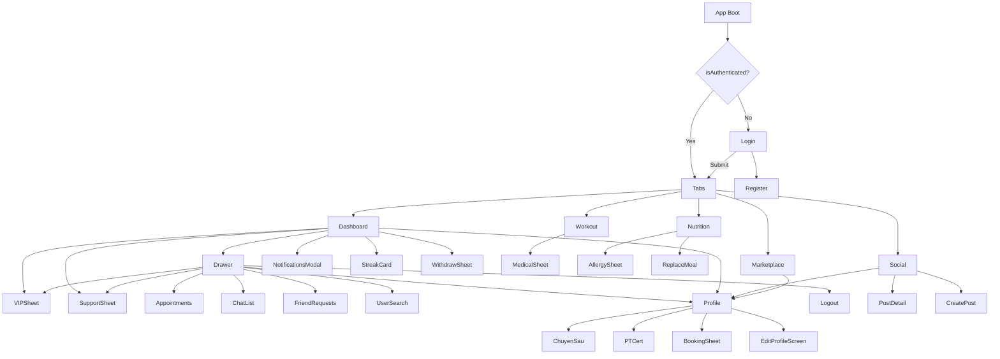

# Screen Specs — Navigation & Wireframes

> Dac ta tung man hinh + sitemap. Moi screen lien ket parity ID (FP-XXX) trong `feature-parity-matrix.md` va task ID (MOB-XXX) trong `tasks.md`.
>
> **Luu y quan trong**: Navigation o day (5 tab bottom, drawer, push stack) la **mot trong cac cau truc kha thi** dua tren content audit. AI trien khai co the de xuat cau truc khac (vd: drawer + tabs bottom + stack inline, hoac bottom navigation 5 tab + present sheet cho profile) neu co ly do — quan trong la **khong mat parity fields/actions/roles** (xem `feature-parity-matrix.md`). Quyet dinh thay doi navigation va layout phai ghi trong `decisions.md`.

## 1. Navigation map (tong quan, de xuat)

```
AuthStack (khi chua auth)
├── LoginScreen (FP-030)
└── RegisterScreen (FP-030)

MainStack (sau auth)
├── BottomTabs (root)
│   ├── DashboardScreen (FP-001, FP-002, FP-034 no)
│   ├── NutritionScreen (FP-014, FP-015, FP-016)
│   ├── WorkoutScreen (FP-017, FP-018, FP-019, FP-020)
│   ├── SocialScreen (FP-008, FP-009, FP-010, FP-011, FP-013)
│   └── MarketplaceScreen (FP-021)
│
├── RootStackOverlay (modal/presentation)
│   ├── ProfileScreen (FP-024..026) <- push khi tap avatar
│   ├── EditProfileScreen (FP-024 edit)
│   ├── ChuyenSauScreen (FP-027)
│   ├── PTCertificatesScreen (FP-028)
│   ├── AppointmentsScreen (FP-022)
│   ├── MessengerScreen + ChatScreen (FP-029)
│   ├── UserSearchScreen (FP-006)
│   ├── FriendRequestsScreen (FP-005)
│   ├── NotificationsScreen (FP-004)
│   ├── DrawerPanel (FP-003) <- left/right slide
│   └── BottomSheet variants
│       ├── BookingSheet (FP-021, FP-026)
│       ├── ReplaceMealSheet (FP-015)
│       ├── AllergySurveySheet (FP-016)
│       └── MedicalSurveySheet (FP-019)
```

## 2. So do mermaid (navigation simplify)



## 3. Man hinh chi tiet

Moi man hinh co:
- **Muc dich**: ai xem, lam gi.
- **Sections**: thu tu noi dung.
- **Components**: token/ID.
- **Actions**: nut chinh/phu.
- **States**: rong, loading, error.
- **Parity IDs**: FP-XXX.
- **Ly do thay doi**: khac ban web ra sao.

---

### 3.1 LoginScreen (FP-030, MOB-119)

- **Muc dich**: nguoi dung dang nhap hoac chuyen sang register.
- **Sections**: branding header (logo + tagline), 2 tab (Dang nhap / Dang ky), form, quick-login row.
- **Fields**: email (type=email), password (>= 6 chars).
- **Actions**: Dang nhap (CTA primary), Quick login HV/PT (2 ghost button).
- **Thay doi so voi web**: tab bar duoc chuyen thanh Material 3 `SegmentedButton`; quick-login thanh chip.

### 3.2 RegisterScreen

#### Buoc 1 — Form chung (ca member va PT)
- Role toggle (Hoi vien | PT)
- Ten hien thi (text, bat buoc)
- Ngay sinh (date, member optional, PT bat buoc)
- Gioi tinh (select Nam/Nu/Khac)
- Email (email, bat buoc)
- Mat khau (password, >= 6)
- Nhap lai mat khau (password, khop)
- Member them: chieu cao (text), can nang (text), muc tieu (textarea).
- PT them: chuyen mon (text, comma-separated), chi phi/buoi (number, default 300000), so nam kinh nghiem (text), chung chi (textarea).

#### Buoc 2 (chi member)
- Chon ngay tap trong tuan (chip group 7 ngay).

- **Actions**: Dang ky (primary); Quay lai (text button).
- **Thay doi**: validation inline duoi field; helper text cho password rule.

### 3.3 DashboardScreen (FP-001, FP-002, FP-035, MOB-101)

- **Muc dich**: tong quan ngay.
- **Sections theo thu tu**:
  1. Header: avatar + ten + streak chip.
  2. Streak card (token warning neu < target, token success neu hoan thanh, theo design system).
  3. Calorie ring (consumed/burned/target).
  4. Quick action grid 2x2: Quet mon / Lich tap / Dat lich PT / Chuyen sau.
  5. Drawer access (neu khong phai fab).
- **Components**: streak-card, progress-ring (size 140dp), card-primary (4 card).
- **Actions**: tap streak → +1 (co confirm), tap ring → nutrition, tap action → tab tuong ung, drawer icon → drawer, bell → notifications, reward → withdraw.
- **States**: loading (skeleton 1 frame), empty (streak=0 → "Bắt đầu streak!" CTA).
- **Thay doi**: ring su dung Material 3 progress indicator (xem `design-system.md` Section 11 Progress) — token semantic, khong copy web neon green glow; bo notch emulator.

### 3.4 NutritionScreen (FP-014, FP-015, FP-016, MOB-111)

- **Sections**:
  1. SegmentedButton: Quet mon | Thuc don.
  2. **Tab Quet mon**: viewfinder (o day chi la animation), buttons: chup (file) / upload / quet lai. Hien thi mon phat hien + macros + portion slider + 3 quick-assign buttons (sang/trua/toi).
  3. **Tab Thuc don**: chip 7 ngay → thuc don cua ngay (sang/trua/toi cards). AI suggest mon thay the (bo sung vao schedule). Weight goal: lose/maintain/gain.
  4. FAB bottom-right: mo AllergySurveySheet.
- **Actions**: portion slider → real-time cap nhat calo; tap "Luu vao nhat ky" → them vao schedule; tap "Skip meal" → set dietState.
- **States**: scan idle / scanning (2s with progress arc) / scanned / saved.

### 3.5 WorkoutScreen (FP-017, FP-018, FP-019, FP-020, MOB-112)

- **Sections**:
  1. Day ribbon (FilterChip 7 ngay).
  2. Time slot chip horizontal (1+ slots).
  3. Workout card list (drag handle + sets/reps/rest/calories).
  4. Footer: "Bat dau tap" primary CTA.
  5. Stub: medical card o top → mo MedicalSurveySheet.
- **Actions**: drag drop reorder, swap (mo sheet 3 lua chon), delete, start, skip (modal confirm).
- **States**: not started / running (timer) / completed.

### 3.6 SocialScreen (FP-008..013, FP-037, MOB-107..110)

- **Sections**:
  1. SegmentedButton: AI Companion | Cong dong.
  2. **AI Companion tab**: chat header (ten Buddy + typing indicator khi can) + chat list (sidebar drawer tu phai) → messages area + input bar.
  3. **Cong dong tab**: feed list cards (post + reactions + comments). FAB hoac header action: Create Post.
- **Components**: post card gom author/time/content/image/reactions/quality badge/comments count.
- **Actions**: react (3 nut), comment (mo post detail), share (mock), open profile (tap avatar).
- **States**: empty (goi y tao post dau tien), loading (skeleton).

### 3.7 MarketplaceScreen (FP-021, MOB-113)

- **Sections**: search bar (optional mock), filter chip (PT / Moi nhat / Gia tang/giam), list PT cards.
- **Card**: cover tint (primaryContainer/tertiaryContainer M3 token, light theme Soft Energy) + avatar + ten + rating + exp + spec tags + verify badge + CTA "Dat lich".
- **Action**: tap info → ProfileScreen, tap CTA → BookingSheet (date + 6 time slot).

### 3.8 ProfileScreen (FP-024..026, MOB-115)

- **Sections**:
  1. Cover tint (primaryContainer neu member, tertiaryContainer neu PT verified) + avatar + ten + verify badge (neu PT) + 2 quick actions (Dat lich / Nhan tin).
  2. Friend status chip row (Kết bạn / Đã gửi / Bạn bè / Hủy kết bạn).
  3. Tab: Thong tin | Bai viet | Reviews (chi PT).
  4. Thong tin: chieu cao/can nang/SĐT/ngay sinh/giới tinh; member co them benh nen/di ung/ngay tap/khung gio; PT co them chuyen mon/exp/price/chung chi/ngay hop.
  5. Bai viet: list cards.
  6. Reviews (PT): list rating + comment.
- **Actions**: tap pencil → EditProfileScreen, tap "Cap nhat chuyen sau" → ChuyenSauScreen (member only), tap "Chung chi" → PTCertificatesScreen (PT only), tap "Dat lich" → BookingSheet, tap "Nhan tin" → MessengerScreen, tap "Ket ban" → friend request.
- **Edit profile** (modal/sheet day du cac field).

### 3.9 ChuyenSauScreen (FP-027, MOB-116)

- Sections: benh nen textarea, di ung textarea, ngay tap chip, time slots cards (add/remove).
- Action: Luu → update profile; Cancel → bo qua.

### 3.10 PTCertificatesScreen (FP-028, MOB-117)

- Sections: status pill top (verified/pending/unverified) + cert list (image card rộng 4:3).
- Actions (self): Yeu cau kiem dinh (neu unverified), Them cert (modal), Admin mo phong (neu self): Duyet / Reset.
- Actions (view): tap image → fullscreen viewer voi Close button.

### 3.11 AppointmentsScreen (FP-022, FP-023, MOB-114)

- Sections: header thang/nam + nav < >; calendar grid; day cell tap → DayDetailModal.
- Modal: list appointment trong ngay; PT action group / member action group.

### 3.12 MessengerScreen + ChatScreen (FP-029, MOB-118)

- **List**: search + list ban be (avatar + last message). Tap → ChatScreen.
- **Chat**: header (avatar + ten + Info icon → ProfileScreen), body messages (bubble), footer input bar + send.
- Action: send → push vao local + cross-user mock.

### 3.13 Drawer (FP-003, MOB-102)

- Sections (tren xuong): Avatar + ten + email; menu list Profile / Search / Friends / Chat / Appointments / VIP / Support / Logout; footer version text.
- Tap item → navigate hoac open sheet.

### 3.14 NotificationsScreen (FP-004, MOB-103)

- Segmented: Tat ca | Loi moi | He thong.
- Item: avatar (neu co) + message + time + dot unread + neu friend_request action.

### 3.15 FriendRequestsScreen (FP-005, MOB-104)

- Segmented: Da nhan | Ban be | Da gui.
- Item: avatar + ten + role + actions (accept/reject/cancel/huy-ket-ban).
- FAB: Search users.

### 3.16 UserSearchScreen (FP-006, MOB-105)

- Search bar + filter chip (all/pt/member/mentor).
- List cards (avatar + ten + role + bio). Tap profile / ket ban / da gui.

### 3.17 Common: BottomSheet (BookingSheet, ReplaceMealSheet, AllergySheet, MedicalSheet)

- Snap medium/full.
- Header: title + close (X).
- Body: form theo loai.
- Footer: Luu + Huy (primary/ghost).

### 3.18 Common: Toast

- Top position, slide-in 200ms, hold 3s.
- Success / warning / error variants.

---

## 4. Wireframe (ASCII sketch) cho Dashboard, Profile HV, Profile PT

> Wireframe ASCII chi minh hoa **bo cuc va relative position**, khong binding visual theme. Mau sac, icon, font chi de phan biet khu vuc — implementation that theo `design-system.md` (Soft Energy, light theme only, xem DEC-019).

### 4.1 Dashboard (ASCII)

```
+--------------------------------+
| ☰   [avatar] Hùng (Bạn)   🔔 3 | <- header (chevron/bell)
+--------------------------------+
|  ╭──────────────────────────╮  |
|  │  STREAK CARD              │ | <- streak (warning if under, success if met)
|  │  🔥 7 ngày                │ |
|  │  "Bạn đang trên chuỗi!"   │ |
|  ╰──────────────────────────╯  |
|  ╭──────────────────────────╮  |
|  │  CALO RING                │ |
|  │  ╭─────╮  1250 kcal       │ |
|  │  │ 65% │  2400 kcal target │ |
|  │  ╰─────╯  Protein/Carb/Fat│ |
|  ╰──────────────────────────╯  |
|  Quick Actions                 |
|  [Scan]  [Lich tap]            | <- 2x2 grid (mock)
|  [PT]    [Chuyen sau]          |
+--------------------------------+
| [Trang chủ] [Quét] [Lịch] [...] | <- bottom nav 5 tab
+--------------------------------+
```

### 4.2 Profile Hoi vien (view + edit)

```
+--------------------------------+
| ←    Hùng (Bạn)           ✏️  | <- header back/edit
+--------------------------------+
|     ╭────╮                      |
|     │ AV │     Hùng (Bạn)       | <- hero tint (primaryContainer M3 token, light theme Soft Energy)
|     ╰────╯     @Hội viên        |
|              [Hồ sơ chuyên sâu] |
+--------------------------------+
| Mục tiêu                       |
| "Đạt body 6 múi..."            |
| Height 175 cm  Weight 70 kg    |
| Phone 0912... Birthday 15/05   |
| Gender Nam                     |
+--------------------------------+
| Sức khỏe (member only)         |
| Bệnh nền: Không có             |
| Dị ứng: Sữa & Lactose, Hải sản|
| Ngày tập: T2, T4, T6           |
| Khung giờ: 18:00 - 20:00       |
+--------------------------------+
| Bài viết (3)                   |
| [post card 1]                  |
| [post card 2]                  |
+--------------------------------+
```

### 4.3 Profile PT (view)

```
+--------------------------------+
| ←    Mai Xuân Tú           ✉️ | <- verified on profile
+--------------------------------+
|     ╭────╮                      |
|     │ AV │   Mai Xuân Tú       | <- hero tint (tertiaryContainer M3 token, light theme Soft Energy)
|     ╰────╯   ⭐ 4.9             |
|             HLV Calisthenics    |
|             3 năm kinh nghiệm  |
|     [Đặt lịch]  [Nhắn tin]    |
+--------------------------------+
| Chuyên môn                     |
| [Calisthenics] [Giảm cân] [SB] |
| Giá: 300.000đ/buổi            |
| Ngày dạy: T2-T7                |
| Giờ trống: 08:00 - 21:00       |
+--------------------------------+
| Chứng chỉ (2)              [Xem] | -> PTCertificatesScreen
+--------------------------------+
| Reviews (12)                   |
| ★★★★★ Học viên A              |
| "..." - 5 ngày trước           |
+--------------------------------+
| Bài viết (5)                   |
| [post card ...]                |
+--------------------------------+
```

---

## 5. Cross-cutting man hinh / Modal / Sheet

Cac modal/sheet sau xuat hien trong nhieu man hinh. Spec giong nhau:

- **BookingSheet** (Marketplace + Profile PT): date picker + 6 time slot buttons + Luu (primary).
- **ReplaceMealSheet**: mon moi + macros + 2 select (ngay, bua) + Ap dung.
- **AllergySheet**: 7 chip + custom text field + Luu.
- **MedicalSheet**: 7 chip + custom text + days chip + time slots (array) + Luu.

---

## 6. Back stack & Android back

- Tab change KHONG pop stack; chi swap.
- Modal sheet co nut X rieng → close modal truoc khi back app co the pop.
- Auth → Main: xoa stack Auth (replace root).
- Logout: clear stack + navigate to Login (replace root).

---

## 7. Modal dismissal & unsaved changes

- EditProfile: hien dialog "Ban co muon luu khong?" neu co thay doi chua luu.
- AllergySurvey / MedicalSurvey: dialog neu co thay doi.
- Cac sheet khac: dialog neu text input co gia tri.

---

## 8. Han che cua phien nay

- Trang thai spec: **DESIGN PHASE**. Can ve lai khi implement de dam bao nhat quan.
- Wireframe chi o ASCII; AI trien khai se dung React Native + tokens thuc te.
- Them flow: chi ghi noi bo chua trien khai.

Khi review, AI moi can check lai moi screen-spec voi parity ID tuong ung.
