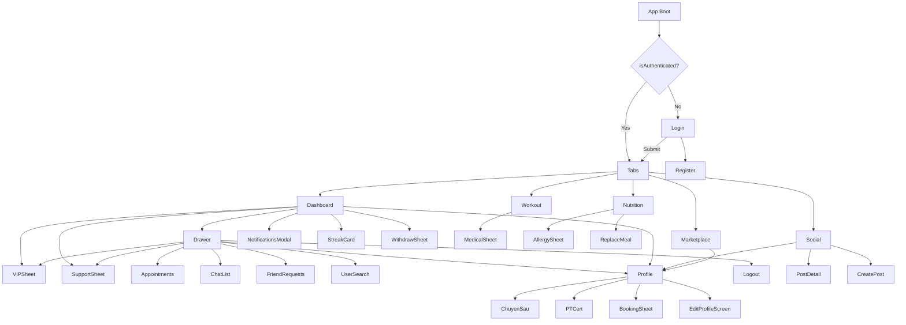

# Screen Specs — Navigation & Wireframes

> Dac ta tung man hinh + sitemap. Moi screen lien ket parity ID (FP-XXX) trong `feature-parity-matrix.md` va task ID (MOB-XXX) trong `tasks.md`.
>
> **Luu y quan trong**: Navigation o day (5 tab bottom, drawer, push stack) la **mot trong cac cau truc kha thi** dua tren content audit. AI trien khai co the de xuat cau truc khac (vd: drawer + tabs bottom + stack inline, hoac bottom navigation 5 tab + present sheet cho profile) neu co ly do — quan trong la **khong mat parity fields/actions/roles** (xem `feature-parity-matrix.md`). Quyet dinh thay doi navigation va layout phai ghi trong `decisions.md`.

## 1. Navigation map (tong quan, de xuat)

```
AuthStack (khi chua auth)
├── LoginScreen (FP-030)
└── RegisterScreen (FP-030)

MainStack (sau auth)
├── BottomTabs (root)
│   ├── DashboardScreen (FP-001, FP-002, FP-034 no)
│   ├── NutritionScreen (FP-014, FP-015, FP-016)
│   ├── WorkoutScreen (FP-017, FP-018, FP-019, FP-020)
│   ├── SocialScreen (FP-008, FP-009, FP-010, FP-011, FP-013)
│   └── MarketplaceScreen (FP-021)
│
├── RootStackOverlay (modal/presentation)
│   ├── ProfileScreen (FP-024..026) <- push khi tap avatar
│   ├── EditProfileScreen (FP-024 edit)
│   ├── ChuyenSauScreen (FP-027)
│   ├── PTCertificatesScreen (FP-028)
│   ├── AppointmentsScreen (FP-022)
│   ├── MessengerScreen + ChatScreen (FP-029)
│   ├── UserSearchScreen (FP-006)
│   ├── FriendRequestsScreen (FP-005)
│   ├── NotificationsScreen (FP-004)
│   ├── DrawerPanel (FP-003) <- left/right slide
│   └── BottomSheet variants
│       ├── BookingSheet (FP-021, FP-026)
│       ├── ReplaceMealSheet (FP-015)
│       ├── AllergySurveySheet (FP-016)
│       └── MedicalSurveySheet (FP-019)
```

## 2. So do mermaid (navigation simplify)



## 3. Man hinh chi tiet

Moi man hinh co:
- **Muc dich**: ai xem, lam gi.
- **Sections**: thu tu noi dung.
- **Components**: token/ID.
- **Actions**: nut chinh/phu.
- **States**: rong, loading, error.
- **Parity IDs**: FP-XXX.
- **Ly do thay doi**: khac ban web ra sao.

---

### 3.1 LoginScreen (FP-030, MOB-119)

- **Muc dich**: nguoi dung dang nhap hoac chuyen sang register.
- **Sections**: branding header (logo + tagline), 2 tab (Dang nhap / Dang ky), form, quick-login row.
- **Fields**: email (type=email), password (>= 6 chars).
- **Actions**: Dang nhap (CTA primary), Quick login HV/PT (2 ghost button).
- **Thay doi so voi web**: tab bar duoc chuyen thanh Material 3 `SegmentedButton`; quick-login thanh chip.

### 3.2 RegisterScreen

#### Buoc 1 — Form chung (ca member va PT)
- Role toggle (Hoi vien | PT)
- Ten hien thi (text, bat buoc)
- Ngay sinh (date, member optional, PT bat buoc)
- Gioi tinh (select Nam/Nu/Khac)
- Email (email, bat buoc)
- Mat khau (password, >= 6)
- Nhap lai mat khau (password, khop)
- Member them: chieu cao (text), can nang (text), muc tieu (textarea).
- PT them: chuyen mon (text, comma-separated), chi phi/buoi (number, default 300000), so nam kinh nghiem (text), chung chi (textarea).

#### Buoc 2 (chi member)
- Chon ngay tap trong tuan (chip group 7 ngay).

- **Actions**: Dang ky (primary); Quay lai (text button).
- **Thay doi**: validation inline duoi field; helper text cho password rule.

### 3.3 DashboardScreen (FP-001, FP-002, FP-035, MOB-101)

- **Muc dich**: tong quan ngay.
- **Sections theo thu tu**:
  1. Header: avatar + ten + streak chip.
  2. Streak card (token warning neu < target, token success neu hoan thanh, theo design system).
  3. Calorie ring (consumed/burned/target).
  4. Quick action grid 2x2: Quet mon / Lich tap / Dat lich PT / Chuyen sau.
  5. Drawer access (neu khong phai fab).
- **Components**: streak-card, progress-ring (size 140dp), card-primary (4 card).
- **Actions**: tap streak ‚Üí +1 (co confirm), tap ring ‚Üí nutrition, tap action ‚Üí tab tuong ung, drawer icon ‚Üí drawer, bell ‚Üí notifications, reward ‚Üí withdraw.
- **States**: loading (skeleton 1 frame), empty (streak=0 → "Bắt đầu streak!" CTA).
- **Thay doi**: ring su dung Material 3 progress indicator (xem `design-system.md` Section 11 Progress) — token semantic, khong copy web neon green glow; bo notch emulator.

### 3.4 NutritionScreen (FP-014, FP-015, FP-016, MOB-111)

- **Sections**:
  1. SegmentedButton: Quet mon | Thuc don.
  2. **Tab Quet mon**: viewfinder (o day chi la animation), buttons: chup (file) / upload / quet lai. Hien thi mon phat hien + macros + portion slider + 3 quick-assign buttons (sang/trua/toi).
  3. **Tab Thuc don**: chip 7 ngay ‚Üí thuc don cua ngay (sang/trua/toi cards). AI suggest mon thay the (bo sung vao schedule). Weight goal: lose/maintain/gain.
  4. FAB bottom-right: mo AllergySurveySheet.
- **Actions**: portion slider ‚Üí real-time cap nhat calo; tap "Luu vao nhat ky" ‚Üí them vao schedule; tap "Skip meal" ‚Üí set dietState.
- **States**: scan idle / scanning (2s with progress arc) / scanned / saved.

### 3.5 WorkoutScreen (FP-017, FP-018, FP-019, FP-020, MOB-112 + MOB-401..406)

- **Sections (WorkoutScreen)**:
  1. Day ribbon (FilterChip 7 ngay).
  2. Khung gio training.
  3. Workout card list (ten bai + sets/reps hoac sets/duration/rest/calories + notes).
  4. Footer: "Bắt đầu tập" primary CTA (push sang `/workout-session`), "AI Thích ứng" secondary.
  5. Phu: khao sat y te, lich su tap.
- **Actions**: tap "Bắt đầu tập" → push `WorkoutSessionScreen` (modal). Khong con checklist thu cong tren man nay.
- **WorkoutSessionScreen** (MOB-404, screen chuyen dung):
  1. Top bar: back (confirm neu dang tap) + tieu de (Ngay + Bai/Hiep) + audio toggle.
  2. Status badge: Chuẩn bị / Đang tập / Nghỉ / Tạm dừng / Tổng kết.
  3. Card chinh: icon + ten bai + hiep hien tai/tong + dong ho dem nguoc hoac reps count lon.
  4. Phase progress bar.
  5. Card huong dan: notes bai tap (text instruction). Video placeholder neu co URL, nguon ghi ro (license).
  6. Next-up preview khi dang nghi.
  7. Overall progress bar cua buoi tap.
  8. Controls: "Xong hiệp" (chi bai reps) + "Tạm dừng / Tiep tuc" + "Bỏ qua nghỉ/hiệp" + "Bỏ qua bài" (skip) + "Kết thúc sớm" (confirm).
- **State machine** (MOB-403, sessionEngine pure): idle ‚Üí prepare ‚Üí exercise ‚Üí rest ‚Üí next set/exercise ‚Üí finished. Timer deadline-based, pause luu `prevStatus`, tick chi chuyen state 1 lan khi deadline het.
- **Audio** (MOB-404, expo-speech): cues tieng Viet ("Bắt đầu hiệp", "Sắp hết", "Nghỉ", "Hiệp tiếp theo", "Hoàn thành"). Fallback text-only neu thiet bi khong co voice `vi-*` (ghi ro trong UI).
- **Background**: AppState listener auto-pause khi background, restore khi quay lai. Hardware back ‚Üí confirm dialog.
- **Checkpoint** (MOB-405): luu engine state vao AsyncStorage key `workout_session_checkpoint_v1`; restore o session moi.
- **History** (MOB-405, buildSessionSummary): ghi 1 record `WorkoutSession` khi FINISHED voi `status` ‚àà {completed, endedEarly, skipped} (KHONG ghi trung nho `markHistorySaved`).
- **Media attribution**: video Push-up d√πng Pixabay CC0 (ghi ro trong fixture + spec).
- **States**: not started / running / paused / finished. Khong con checklist tung bai tren WorkoutScreen.

### 3.6 SocialScreen (FP-008..013, FP-037, MOB-107..110)

- **Sections**:
  1. SegmentedButton: AI Companion | Cong dong.
  2. **AI Companion tab**: chat header (ten Buddy + typing indicator khi can) + chat list (sidebar drawer tu phai) ‚Üí messages area + input bar.
  3. **Cong dong tab**: feed list cards (post + reactions + comments). FAB hoac header action: Create Post.
- **Components**: post card gom author/time/content/image/reactions/quality badge/comments count.
- **Actions**: react (3 nut), comment (mo post detail), share (mock), open profile (tap avatar).
- **States**: empty (goi y tao post dau tien), loading (skeleton).

### 3.7 MarketplaceScreen (FP-021, MOB-113)

- **Sections**: search bar (optional mock), filter chip (PT / Moi nhat / Gia tang/giam), list PT cards.
- **Card**: cover tint (primaryContainer/tertiaryContainer M3 token, light theme Soft Energy) + avatar + ten + rating + exp + spec tags + verify badge + CTA "Dat lich".
- **Action**: tap info ‚Üí ProfileScreen, tap CTA ‚Üí BookingSheet (date + 6 time slot).

### 3.8 ProfileScreen (FP-024..026, MOB-115)

- **Sections**:
  1. Cover tint (primaryContainer neu member, tertiaryContainer neu PT verified) + avatar + ten + verify badge (neu PT) + 2 quick actions (Dat lich / Nhan tin).
  2. Friend status chip row (Kết bạn / Đã gửi / Bạn bè / Hủy kết bạn).
  3. Tab: Thong tin | Bai viet | Reviews (chi PT).
  4. Thong tin: chieu cao/can nang/SĐT/ngay sinh/giới tinh; member co them benh nen/di ung/ngay tap/khung gio; PT co them chuyen mon/exp/price/chung chi/ngay hop.
  5. Bai viet: list cards.
  6. Reviews (PT): list rating + comment.
- **Actions**: tap pencil ‚Üí EditProfileScreen, tap "Cap nhat chuyen sau" ‚Üí ChuyenSauScreen (member only), tap "Chung chi" ‚Üí PTCertificatesScreen (PT only), tap "Dat lich" ‚Üí BookingSheet, tap "Nhan tin" ‚Üí MessengerScreen, tap "Ket ban" ‚Üí friend request.
- **Edit profile** (modal/sheet day du cac field).

### 3.9 ChuyenSauScreen (FP-027, MOB-116)

- Sections: benh nen textarea, di ung textarea, ngay tap chip, time slots cards (add/remove).
- Action: Luu ‚Üí update profile; Cancel ‚Üí bo qua.

### 3.10 PTCertificatesScreen (FP-028, MOB-117)

- Sections: status pill top (verified/pending/unverified) + cert list (image card r·ªông 4:3).
- Actions (self): Yeu cau kiem dinh (neu unverified), Them cert (modal), Admin mo phong (neu self): Duyet / Reset.
- Actions (view): tap image ‚Üí fullscreen viewer voi Close button.

### 3.11 AppointmentsScreen (FP-022, FP-023, MOB-114)

- Sections: header thang/nam + nav < >; calendar grid; day cell tap ‚Üí DayDetailModal.
- Modal: list appointment trong ngay; PT action group / member action group.

### 3.12 MessengerScreen + ChatScreen (FP-029, MOB-118)

- **List**: search + list ban be (avatar + last message). Tap ‚Üí ChatScreen.
- **Chat**: header (avatar + ten + Info icon ‚Üí ProfileScreen), body messages (bubble), footer input bar + send.
- Action: send ‚Üí push vao local + cross-user mock.

### 3.13 Drawer (FP-003, MOB-102)

- Sections (tren xuong): Avatar + ten + email; menu list Profile / Search / Friends / Chat / Appointments / VIP / Support / Logout; footer version text.
- Tap item ‚Üí navigate hoac open sheet.

### 3.14 NotificationsScreen (FP-004, MOB-103)

- Segmented: Tat ca | Loi moi | He thong.
- Item: avatar (neu co) + message + time + dot unread + neu friend_request action.

### 3.15 FriendRequestsScreen (FP-005, MOB-104)

- Segmented: Da nhan | Ban be | Da gui.
- Item: avatar + ten + role + actions (accept/reject/cancel/huy-ket-ban).
- FAB: Search users.

### 3.16 UserSearchScreen (FP-006, MOB-105)

- Search bar + filter chip (all/pt/member/mentor).
- List cards (avatar + ten + role + bio). Tap profile / ket ban / da gui.

### 3.17 Common: BottomSheet (BookingSheet, ReplaceMealSheet, AllergySheet, MedicalSheet)

- Snap medium/full.
- Header: title + close (X).
- Body: form theo loai.
- Footer: Luu + Huy (primary/ghost).

### 3.18 Common: Toast

- Top position, slide-in 200ms, hold 3s.
- Success / warning / error variants.

---

## 4. Wireframe (ASCII sketch) cho Dashboard, Profile HV, Profile PT

> Wireframe ASCII chi minh hoa **bo cuc va relative position**, khong binding visual theme. Mau sac, icon, font chi de phan biet khu vuc — implementation that theo `design-system.md` (Soft Energy, light theme only, xem DEC-019).

### 4.1 Dashboard (ASCII)

```
+--------------------------------+
| ‚ò∞   [avatar] H√πng (B·∫°n)   üîî 3 | <- header (chevron/bell)
+--------------------------------+
|  ╭──────────────────────────╮  |
|  │  STREAK CARD              │ | <- streak (warning if under, success if met)
|  │  🔥 7 ngày                │ |
|  │  "Bạn đang trên chuỗi!"   │ |
|  ╰──────────────────────────╯  |
|  ╭──────────────────────────╮  |
|  │  CALO RING                │ |
|  │  ╭─────╮  1250 kcal       │ |
|  │  │ 65% │  2400 kcal target │ |
|  │  ╰─────╯  Protein/Carb/Fat│ |
|  ╰──────────────────────────╯  |
|  Quick Actions                 |
|  [Scan]  [Lich tap]            | <- 2x2 grid (mock)
|  [PT]    [Chuyen sau]          |
+--------------------------------+
| [Trang chủ] [Quét] [Lịch] [...] | <- bottom nav 5 tab
+--------------------------------+
```

### 4.2 Profile Hoi vien (view + edit)

```
+--------------------------------+
| ←    Hùng (Bạn)           ✏️  | <- header back/edit
+--------------------------------+
|     ╭────╮                      |
|     │ AV │     Hùng (Bạn)       | <- hero tint (primaryContainer M3 token, light theme Soft Energy)
|     ╰────╯     @Hội viên        |
|              [Hồ sơ chuyên sâu] |
+--------------------------------+
| Mục tiêu                       |
| "Đạt body 6 múi..."            |
| Height 175 cm  Weight 70 kg    |
| Phone 0912... Birthday 15/05   |
| Gender Nam                     |
+--------------------------------+
| Sức khỏe (member only)         |
| Bệnh nền: Không có             |
| Dị ứng: Sữa & Lactose, Hải sản|
| Ngày tập: T2, T4, T6           |
| Khung gi·ªù: 18:00 - 20:00       |
+--------------------------------+
| Bài viết (3)                   |
| [post card 1]                  |
| [post card 2]                  |
+--------------------------------+
```

### 4.3 Profile PT (view)

```
+--------------------------------+
| ←    Mai Xuân Tú           ✉️ | <- verified on profile
+--------------------------------+
|     ╭────╮                      |
|     │ AV │   Mai Xuân Tú       | <- hero tint (tertiaryContainer M3 token, light theme Soft Energy)
|     ╰────╯   ⭐ 4.9             |
|             HLV Calisthenics    |
|             3 năm kinh nghiệm  |
|     [Đặt lịch]  [Nhắn tin]    |
+--------------------------------+
| Chuyên môn                     |
| [Calisthenics] [Gi·∫£m c√¢n] [SB] |
| Giá: 300.000đ/buổi            |
| Ngày dạy: T2-T7                |
| Giờ trống: 08:00 - 21:00       |
+--------------------------------+
| Chứng chỉ (2)              [Xem] | -> PTCertificatesScreen
+--------------------------------+
| Reviews (12)                   |
| ★★★★★ Học viên A              |
| "..." - 5 ngày trước           |
+--------------------------------+
| Bài viết (5)                   |
| [post card ...]                |
+--------------------------------+
```

---

## 5. Content parity checklist (Dashboard, Profile HV, Profile PT)

> Day du field theo `current-app-audit.md` Section 7. Phai xuat hien tren UI mobile va khong mat content.

### 5.1 Dashboard (FP-001, FP-002, FP-035)

| Truong/Block | Source | Bieu thi tren UI | Token dung |
|---|---|---|---|
| Avatar | `usersDb[me].avatar` | Avatar component 56dp header | `surfaceContainerLowest` bg, `outline` border |
| Ten user | `usersDb[me].name` | Header title `headline.medium` | `onSurface` |
| Streak number | `streak` | Counter `display.large` 800 weight | `onSurface` text, `secondary` icon streak (secondaryContainer icon-bg neu hover) |
| Streak label "ngay lien tuc" | derived | `body.medium` | `onSurfaceVariant` |
| Streak warning | streak < target (7) | Card warning | `warning` border 1dp, `warning` text |
| Streak success | streak >= target | Card success | `success` border 1dp, `success` text |
| Tap streak | +1 confirm | Action sheet "Xac nhan +1?" | primary button |
| Calories consumed | `caloriesConsumed` | Ring center `display.medium` | `onSurface` |
| Calories target | derived (BMR + goal) | Ring caption `body.small` | `onSurfaceVariant` |
| Calories burned | `caloriesBurned` | Below ring caption | `onSurfaceVariant` |
| Calories % | derived | Ring fill (progress ring SVG) | `primary` fill, `surfaceContainerHigh` track |
| Protein bar | derived macro | LinearProgressIndicator 8dp height | `primary` fill |
| Carb bar | derived macro | LinearProgressIndicator | `secondary` fill (warm accent) |
| Fat bar | derived macro | LinearProgressIndicator | `tertiary` fill (chi khi co gamification) — neu khong co gamification thi`surfaceContainerHigh` placeholder |
| Quick action: Quet mon | tap ‚Üí Nutrition tab Scan | Card 2x2 grid icon + label | `surfaceContainerLowest` + `outlineVariant` |
| Quick action: Lich tap | tap ‚Üí Workout tab | Card | same |
| Quick action: Dat lich PT | tap ‚Üí Marketplace tab | Card | same |
| Quick action: Chuyen sau | tap ‚Üí ChuyenSau | Card | same |
| Notification count | `notifications.length` | Bell badge | `error` bg + `onError` text |
| Drawer access | icon hamburger | header left | `onSurfaceVariant` |
| Reward button | `rewardPoints` > 0 | Reward icon header right | `success` icon tint |
| VIP button | (sheet) | Diamond icon | `tertiaryContainer` bg + `tertiary` icon (chi khi co gamification VIP); neu khong co ‚Üí skip |
| Support button | (sheet) | Help icon | `onSurfaceVariant` icon |
| Streak tap state | empty streak=0 | Card empty "Bắt đầu streak!" CTA | primary button |

**Action map**: `streak ‚Üí confirmSheet(+1)`; `ring ‚Üí nutrition tab`; `quick action ‚Üí corresponding tab`; `bell ‚Üí notifications modal`; `reward ‚Üí withdraw sheet`; `diamond ‚Üí vip sheet`; `help ‚Üí support sheet`; `hamburger ‚Üí drawer`; `avatar ‚Üí profile self`.

### 5.2 Profile Hoi vien (FP-024..026 self view)

| Truong/Block | Source | Bieu thi tren UI | Token dung |
|---|---|---|---|
| Hero bg | member | tint top 25% screen | `primaryContainer` |
| Avatar | `avatar` | 100dp center hero | `surfaceContainerLowest` border 3dp `primary` |
| Ten | `name` | `headline.large` | `onSurface` |
| Role chip | `isPt === false` | Chip "Hoi vien" | `primaryContainer` bg, `onPrimaryContainer` text |
| Edit button | `isSelf` | IconButton pencil top-right | `onSurfaceVariant` icon |
| Edit profile button | self | Filled button "Sua ho so" hero | `primary` bg, `onPrimary` text |
| Friend status chip row | `friendsList.includes(viewerEmail)` | Row chip | unselected: `outlineVariant` border + `onSurfaceVariant` text; selected: `primaryContainer` bg + `onPrimaryContainer` text |
| Muc tieu block | `bio` / `goal` | Card section "Muc tieu" | `surfaceContainerLowest` + `outlineVariant` |
| Goal text | `bio` or `goal` | `body.large` | `onSurface` |
| Height | `height` | Label + value row | `onSurfaceVariant` label, `onSurface` value |
| Weight | `weight` | Row | same |
| Phone | `phone` | Row | same |
| Birthday | `birthday` | Row | same |
| Gender | `gender` | Row | same |
| Email | `email` | Row | `onSurfaceVariant` label, `onSurface` value |
| Suc khoe block | `isPt === false` | Card section "Suc khoe (member only)" | same |
| Benh nen | `medicalCondition` | Row "Benh nen: ..." or "Khong co" | `onSurfaceVariant` / `onSurface` |
| Di ung | `allergies[]` | Row "Di ung: ..." | same |
| Ngay tap | `trainingDays[]` | Row "Ngay tap: T2, T4, T6" | same |
| Khung gio | `trainingTime` string | Row "Khung gio: 18:00 - 20:00" | same |
| Cap nhat chuyen sau button | self member | Outlined button | `secondaryContainer` bg, `onSecondaryContainer` text, `outlineVariant` border |
| Bai viet block | `usersDb[me].posts[]` or `conversations` derived | Card section "Bai viet (n)" + list | `surfaceContainerLowest` |
| Post card | id/title/content/time/reactions/comments | Card list row | same |
| Streak (in profile) | `streak` | Streak badge chip | `secondaryContainer` bg, `onSecondaryContainer` text + `secondary` icon |
| Reward points (in profile) | `rewardPoints` | Badge chip | `success` bg-tint, `success` text |

**Action map**: `pencil ‚Üí edit modal/sheet`; `Sua ho so ‚Üí EditProfileScreen`; `Cap nhat chuyen sau ‚Üí ChuyenSauScreen`; `post card ‚Üí PostDetailScreen`; `friend chip ‚Üí friend request sheet`.

### 5.3 Profile PT (FP-024..026 other view, FP-021..023)

| Truong/Block | Source | Bieu thi tren UI | Token dung |
|---|---|---|---|
| Hero bg | PT verified | tint top 25% screen | `tertiaryContainer` (verified) |
| Avatar | `avatar` | 100dp center hero | `surfaceContainerLowest` border 3dp `tertiary` |
| Ten | `name` | `headline.large` | `onSurface` |
| Verify badge | `isVerified` | IconBadge "Verified" | `tertiaryContainer` bg, `onTertiaryContainer` text + `tertiary` icon |
| Role chip | `isPt === true` | Chip "HLV" | `tertiaryContainer` bg, `onTertiaryContainer` text |
| Rating | derived from reviews | Row ⭐ 4.9 (n reviews) | `warning` icon, `onSurface` text |
| Spec | `spec[]` (max 4) | Row chip group "Chuyen mon" | `secondaryContainer` bg, `onSecondaryContainer` text |
| Exp | `exp` | Row "3 nam kinh nghiem" | `onSurfaceVariant` label, `onSurface` value |
| Price | `price` | Row "300.000đ/buoi" | same |
| Training days | `trainingDays[]` | Row "Ngay day: T2-T7" | same |
| Available hours | `trainingTime` / `trainingTimes` | Row "Gio trong: 08:00 - 21:00" | same |
| Dat lich CTA | view other | Primary button hero | `primary` bg, `onPrimary` text |
| Nhan tin CTA | view other | Secondary button hero | `secondaryContainer` bg + `outlineVariant` border, `onSecondaryContainer` text |
| Ket ban CTA | view other + not friend | Outlined button | `surfaceContainerLowest` bg + `outlineVariant` border, `onSurface` text |
| Huy ket ban | already friend | Outlined button | same |
| Chuyen mon block | `spec[]` | Card section "Chuyen mon" | `surfaceContainerLowest` + `outlineVariant` |
| Spec chip | `spec[i]` | Filter chip (display only) | `secondaryContainer` bg, `onSecondaryContainer` text |
| Gia block | `price` | Row | `onSurfaceVariant` label, `onSurface` value |
| Ngay day block | `trainingDays[]` | Row | same |
| Gio trong block | `trainingTime` / `trainingTimes[]` | Row | same |
| Chung chi block | `certificates[]` | Card section "Chung chi (n)" + [Xem] button ‚Üí PTCertificatesScreen | `surfaceContainerLowest` + `outlineVariant` |
| Cert status pill | `certificateStatus` | Top of cert screen | `success` (verified) / `warning` (pending) / `error` (unverified) |
| Reviews block | derived from `appointments` + comments | Card section "Reviews (n)" | `surfaceContainerLowest` + `outlineVariant` |
| Review item | rating + comment + time + author | List row | `warning` icon star, `onSurface` text |
| Bai viet block | PT posts | Card section "Bai viet (n)" | same |
| Post card | post fields | Card list row | same |

**Action map**: `Dat lich ‚Üí BookingSheet(date + 6 slot)`; `Nhan tin ‚Üí MessengerScreen`; `Ket ban ‚Üí friend request sheet`; `[Xem] chung chi ‚Üí PTCertificatesScreen`; `post ‚Üí PostDetailScreen`.

### 5.4 Thong tin chung cho ca HV va PT (neu xem other)

| Truong | Source | UI |
|---|---|---|
| Email | `email` | Row (hidden neu `!isSelf`?) — hien thi theo privacy mac dinh cua web |
| Goal/Muc tieu | `bio` / `goal` | Card section |
| Friend status | `friendsList` | Chip row |

---

## 6. Cross-cutting man hinh / Modal / Sheet

Cac modal/sheet sau xuat hien trong nhieu man hinh. Spec giong nhau:

- **BookingSheet** (Marketplace + Profile PT): date picker + 6 time slot buttons + Luu (primary).
- **ReplaceMealSheet**: mon moi + macros + 2 select (ngay, bua) + Ap dung.
- **AllergySheet**: 7 chip + custom text field + Luu.
- **MedicalSheet**: 7 chip + custom text + days chip + time slots (array) + Luu.

---

## 7. Back stack & Android back

- Tab change KHONG pop stack; chi swap.
- Modal sheet co nut X rieng ‚Üí close modal truoc khi back app co the pop.
- Auth ‚Üí Main: xoa stack Auth (replace root).
- Logout: clear stack + navigate to Login (replace root).

---

## 8. Modal dismissal & unsaved changes

- EditProfile: hien dialog "Ban co muon luu khong?" neu co thay doi chua luu.
- AllergySurvey / MedicalSurvey: dialog neu co thay doi.
- Cac sheet khac: dialog neu text input co gia tri.

---

## 9. Han che cua phien nay

- Trang thai spec: **DESIGN PHASE**. Can ve lai khi implement de dam bao nhat quan.
- Wireframe chi o ASCII; AI trien khai se dung React Native + tokens thuc te.
- Them flow: chi ghi noi bo chua trien khai.

Khi review, AI moi can check lai moi screen-spec voi parity ID tuong ung.


## Ghi chu visual (DEC-024 + DEC-025, 2026-09-18)

**DashboardScreen (FP-001/002/035)**: boc trong HomepageBackground (4 layers: solid + gradient mint teal + watermark 'Fitmate' + content). StreakCard boc GlassCard (radius 20). CalorieRing + QuickActionGrid giu Card mat dinh (de doc so lieu). Scroll padding bottom = 96dp (pill + inset + buffer).

**Bottom Tabs (5 tab)**: floating pill ó chi tiet DEC-024 trong design-system.md Section 14. Glass surface, active capsule primaryContainer, badge tu real state only. Safe area theo DEC-021 (useSafeAreaInsets).

**Cac tab khac (nutrition/workout/social/marketplace)**: ScrollView padding bottom = 96dp de noi dung cuoi khong bi pill che. Card nhieu chu/so lieu giu surface dac.
